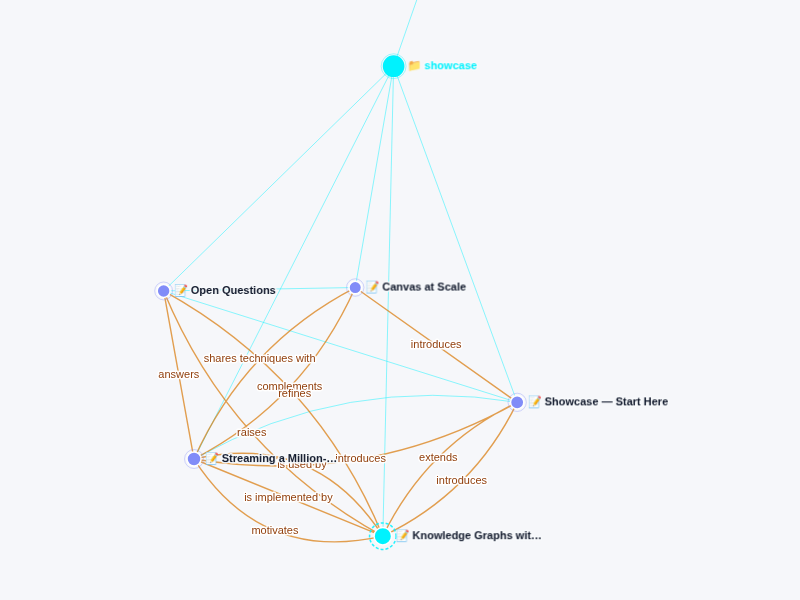
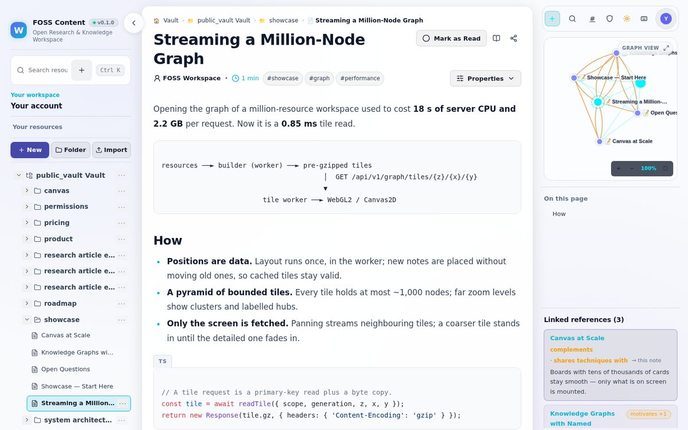
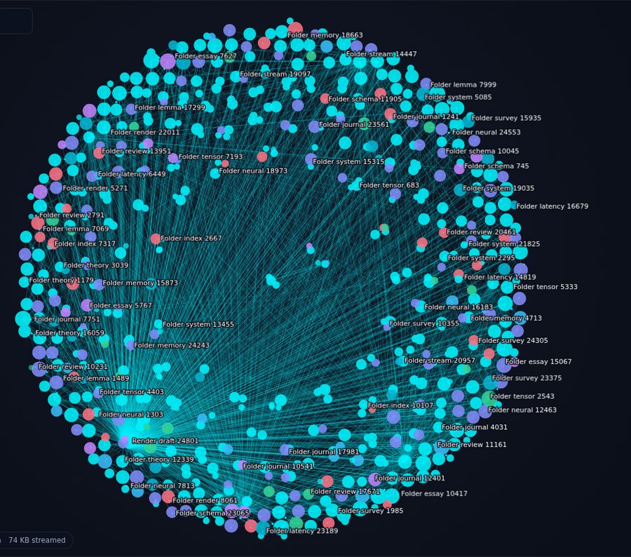
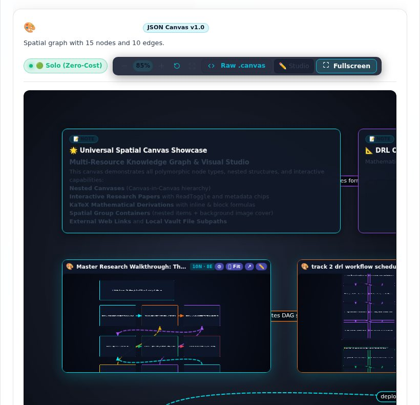

# FOSS Content Workspace

A ReBAC-isolated research & knowledge workspace — markdown vaults, PDFs, spatial
canvases, IAM permission management, tagging, and Obsidian/Quartz sync — built
on Astro.

> **Design system is mandatory.** All UI work MUST follow the rules in
> [`docs/design-system.md`](docs/design-system.md). New surfaces that bypass the
> token → primitive → component layers will be rejected.

> **Product and engineering goal:** [`docs/GOALS.md`](docs/GOALS.md) is the
> source of truth for the 10–100 user target, constrained runtime budget, and
> engineering priorities.

## Quick start

Requires Node ≥ 22.12 and Docker.

```sh
npm install
docker compose up -d postgres openfga meilisearch   # data services (ports 5435, 8085, 7705)
npx tsx scripts/init-openfga.ts     # creates the permission store (writes OPENFGA_STORE_ID to .env if present)
npm run migrate:up                  # database schema
npx tsx scripts/sync_vault.ts       # loads content/ — including the public showcase
npm run dev                         # http://localhost:4321
```

The full stack also runs with `docker compose up -d` (app on http://localhost:4322).
For the streamed graph on large workspaces, run `npm run worker` (keeps it
fresh) or `npm run graph:build` once.

Then open **Showcase — Start Here** (`/?doc=showcase-start-here`), a short public
tour of the features below.

## Check these out

**Named relationships.** A link can say *how* two notes relate, and two notes can
be joined by several. Write `[[note|shown text|relationship]]` inline, or
`relationships: [cites:note, extends:other]` in frontmatter. In the graph they are
the amber edges — several per pair fan out as curves — and in *Linked references*
a quiet chip shows the name; hover a card for the full list. On a canvas, a
labelled edge between two note cards is the same statement — it shows up in the
graph as that relationship.

<p align="center"></p>
<p align="center"></p>

**A graph that streams.** Large workspaces switch to a tiled, level-of-detail
graph: positions are precomputed, the graph is cut into map-style tiles, and the
browser fetches only what is on screen. Below: 899,097 nodes, 74 KB transferred,
~250 DOM nodes. Opening it costs the server 0.85 ms per tile instead of 18 s and
2.2 GB per request.

<p align="center"></p>

**Canvases that stay fast.** Only cards near the viewport are mounted, far zoom
paints simple shapes, and dense layers slide a snapshot while you pan. A 50k-card
board keeps 33 ms worst-case frames (was 2.6 s); the 10k-card editor went from
283k DOM nodes to 1.9k. Edges bind anywhere on a card's border (drop a
connection where you want it, or drag an endpoint along the edge), snapping to
the side's midpoint when close.

<p align="center"></p>

Numbers, design and limits: [`docs/perf/SCALING.md`](docs/perf/SCALING.md).
Reproducible benchmarks: [`bench/`](bench/README.md).

## Architecture overview

- **UI**: Astro + React (`src/components/ui/`) on a token-based design system
  (`src/styles/tokens.css`, `src/styles/primitives.css`).
- **Content**: markdown/JSON canvases in `content/`, rendered via
  `src/lib/` renderers.
- **Data**: PostgreSQL + Meilisearch + OpenFGA (see `docker-compose.yml`).
- **Scale**: the graph streams level-of-detail tiles and the canvas virtualises
  its board, so both views stay smooth at a million nodes (the surrounding
  page shell is still O(N) — see "Limits" in
  [`docs/perf/SCALING.md`](docs/perf/SCALING.md)).
- **Relationships**: parsed in `src/lib/relationships.ts`; stored per note as
  `metadata.relationships` (declared) and `metadata.linkRelationships` (inline),
  and per canvas as `metadata.edgeRelationships` (labelled edges).
- **Shared viewer core** (`src/lib/viewer/`): one camera (pan/zoom algebra and
  animated fly-to) for the canvas and the graph, parallel-link spreading,
  motion snapshots and GPU detection.
- **Docs**: project guidance lives in `docs/` and `AGENTS.md`. Product and engineering goals: [`docs/GOALS.md`](docs/GOALS.md). UI rules: [`docs/design-system.md`](docs/design-system.md). Scale implementation notes: [`docs/plans/multiuser-scale.md`](docs/plans/multiuser-scale.md). Excalidraw fork + render-anything node roadmap: [`docs/plans/excalidraw-custom-element.md`](docs/plans/excalidraw-custom-element.md).

## Commands

| Command                   | Action                                           |
| :------------------------ | :----------------------------------------------- |
| `npm install`             | Installs dependencies                            |
| `npm run dev`             | Starts local dev server at `localhost:4321`      |
| `npm run build`           | Build your production site to `./dist/`          |
| `npm run preview`         | Preview your build locally, before deploying     |
| `npx tsc --noEmit`        | Type-check the project                           |
| `npm run test:e2e`        | Run Playwright end-to-end tests                  |
| `npm run migrate:up`      | Apply database migrations                        |
| `npm run worker`          | Background jobs, including keeping the streamed graph fresh |
| `npm run graph:build`     | Build/refresh the tiled graph once               |
| `npm run test:unit`       | Unit tests (fast, no services)                   |
| `npm run bench:graph-server` | Server-side graph benchmark (see `bench/README.md`) |
| `npm run astro ...`       | Run CLI commands like `astro add`, `astro check` |

Full Astro documentation: https://docs.astro.build
