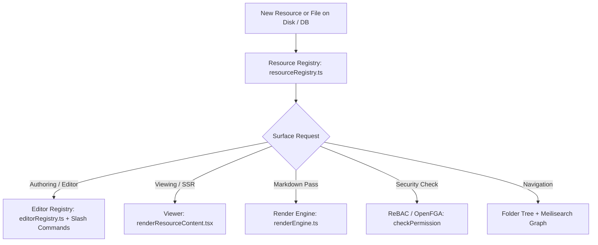

# Extensible Resource Architecture & Plugin Guide

> [!important] Single Source of Truth
> In this workspace, **never hardcode ad-hoc `TYPE_META`, `TYPE_LABELS`, or custom switch-cases across pages**. 
> All resource types, viewing components, editor blocks, and permissions must be registered through the centralized registries:
> 1. Resource Type Registry: `src/lib/registry/resourceRegistry.ts`
> 2. Polymorphic Content Viewer: `src/lib/viewer/renderResourceContent.tsx`
> 3. Editor Block & Slash Command Registry: `src/lib/registry/editorRegistry.ts`
> 4. Markdown & Block Render Engine: `src/lib/renderEngine.ts`

---

## 1. How the Architecture Works

Unlike static-only site generators, the **FOSS Content Workspace** is a unified, multi-tenant research ecosystem powered by:
- **Server-Driven Astro SSR (Node)**: All authorization, transclusion expansion, LaTeX parsing, and BibTeX citation lookups happen on the server.
- **OpenFGA ReBAC Access Control**: Every resource is an object with fine-grained relationships (`viewer`, `editor`, `owner`).
- **Polymorphic Resource Factory**: Resources are registered with metadata, file extensions, icons, and category definitions.
- **TipTap Modular Extensions**: Interactive components (Bases, Mermaid, Canvas, Excalidraw, Jupyter, Google Docs) can be inserted via slash commands (`/`) and edited with live collaboration.



---

## 2. End-to-End Checklist: Adding a New Resource Type Without Breaking Anything

When you add a new resource type (e.g. `audio`, `model_3d`, `workflow_dag`), follow this checklist:

### Step 1: Register the Resource Type in `src/lib/registry/resourceRegistry.ts`
Define its canonical identity, icon, color tokens, and file matcher:

```typescript
registerResourceType({
  type: 'workflow_dag',
  label: 'Workflow DAG Pipeline',
  icon: '⚡',
  accentColor: '#8b5cf6',
  category: 'data',
  description: 'Directed Acyclic Graph workflow with execution state and node logs.',
  fileExtensions: ['.dag', '.workflow.json'],
  canCollab: true,
  canEmbed: true,
  matcher: (item) => Boolean(
    item.type === 'workflow_dag' ||
    item.id?.startsWith('dag:') ||
    (item.file || '').endsWith('.dag')
  ),
});
```

### Step 2: Implement or Mount the Component in `renderResourceContent.tsx`
In `src/lib/viewer/renderResourceContent.tsx`, add the polymorphic viewer case:

```tsx title="src/lib/viewer/renderResourceContent.tsx"
case 'workflow_dag': {
  return (
    <WorkflowDagViewer
      resourceId={props.resourceId}
      data={props.rawJson}
      currentUser={props.currentUser}
      height={props.height}
    />
  );
}
```

### Step 3: (If Authorable) Register in `src/lib/registry/editorRegistry.ts`
If users can insert this component into rich notes via `/` slash commands:

```typescript
registerEditorBlock({
  id: 'workflow_dag',
  title: 'Workflow DAG Pipeline',
  description: 'Insert an interactive workflow DAG pipeline',
  icon: '⚡',
  category: 'Components',
  extension: DagExtension,
  action: (editor) => {
    editor.chain().focus().insertDagBlock().run();
  },
});
```

### Step 4: Handle Markdown Serialization in `src/lib/render/customBlocks.ts`
If the block serializes to HTML markup (e.g. `<div data-dag-block="true" ...></div>`), add a transformer to `applyCustomEditorBlocks()`:

```typescript
text = text.replace(/<div\s+([^>]*?data-dag-block=["']true["'][^>]*?)>([\s\S]*?)<\/div>/gi, (_m, attrs) => {
  return renderDagBlock(attrs);
});
```

### Step 5: Verify OpenFGA / Database Compatibility
- Resources stored in PostgreSQL must have an `id` prefixed by `type:` (e.g., `document:my-note`, `canvas:arch-board`, `dag:pipeline-1`).
- The OpenFGA authorization model checks `document:<id>`, `folder:<id>`, etc. Ensure the object ID matches the model namespace or uses the universal resource tuple.

---

## 3. Supported Content Features in Notes

### Obsidian Callouts & Admonitions
All 12 Obsidian callout types are natively supported with collapsible variants (`+` or `-`):

> [!note] Note Callout
> Standard informative note with cyan accent.

> [!tip]+ Expanded Tip (Default Open)
> This tip is visible immediately on render.

> [!warning]- Collapsed Warning (Click to Expand)
> Hidden by default, useful for spoilers or long configurations.

### Academic Citations & BibTeX
Use `[@citationKey]` or `[@key, p. 42]` anywhere in your text. The engine matches entries from `references.bib` and auto-generates a bibliography:
- Example: `[@templeton2024scaling]` renders as [@templeton2024scaling].
- Multiple citations: `[@vaswani2017attention; @doe2025agentic]`.

### Transclusions & Embeds
- Full note embed: `![[note-slug]]`
- Heading embed: `![[note-slug#Methodology]]`
- Block embed: `![[note-slug#^my-block-id]]`
- Bounded depth: Capped at depth 3 to eliminate circular infinite transclusions.

### Interactive Code & Copy Blocks
Every fenced code block automatically receives syntax highlighting via Shiki and an accessible one-click copy button:

```python
# Example of clean extensible code
def verify_resource(resource_id: str) -> bool:
    return resource_id.startswith(("document:", "canvas:", "pdf:", "jupyter:"))
```

---

## 4. Troubleshooting & Best Practices

| Symptom | Root Cause | Fix |
| :--- | :--- | :--- |
| TypeScript error: `matcher: boolean \| undefined` | Matcher arrow function returns truthy value instead of strict `boolean`. | Wrap logic in `Boolean(...)` or `!!(...)`. |
| Broken layout when adding new resource | New resource type has hardcoded CSS or missing view case. | Add viewer case in `renderResourceContent.tsx` using `src/components/ui/` primitives. |
| ReBAC "Access Denied" for new type | Object name prefix missing or not mapped in OpenFGA tuples. | Ensure ID format matches `type:slug` and tuple relationship exists in database. |
| Code block unstyled or raw text | Code block language unregistered or missing from Shiki bundle. | Fallback plain code card will safely render without crashing SSR. |
