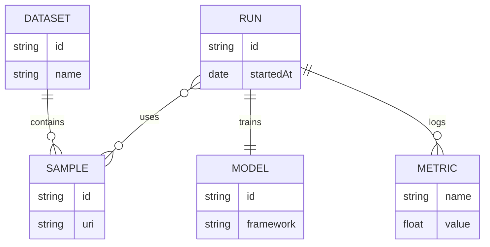

# Bringing paper to life: A modern template for scientific writing

Welcome to this open source **research article template**. It helps you publish **clear**, **modern**, and **interactive technical writing** with **minimal setup**.

<Sidenote>
  Read time: 20–25 minutes.
</Sidenote>

Grounded in up to date good practices in web dev, it favors **interactive explanations**, **clear notation**, and **inspectable examples** over static snapshots.

Available on [GitHub](https://github.com/example-author/research-article-template) deployable on [Hugging Face Spaces](https://huggingface.co/spaces/research-template/research-article-template).

#### Features

<div className="tag-list">
  <span className="tag">Markdown-based</span>
  <span className="tag">KaTeX math</span>
  <span className="tag">Syntax highlighting</span>
  <span className="tag">Academic citations</span>
  <span className="tag">Footnotes</span>
  <span className="tag">Table of contents</span>
  <span className="tag">Mermaid diagrams</span>
  <span className="tag">Plotly ready</span>
  <span className="tag">D3.js ready</span>
  <span className="tag">HTML embeds</span>
  <span className="tag">Gradio app embeds</span>
  <span className="tag">Dataviz color palettes</span>
  <span className="tag">Optimized images</span>
  <span className="tag">Lightweight bundle</span>
  <span className="tag">SEO friendly</span>
  <span className="tag">Automatic build</span>
  <span className="tag">Automatic PDF export</span>
  <span className="tag">Dark theme</span>
  <span className="tag">Mobile friendly</span>
  <span className="tag">Latex import</span>
  <span className="tag">Template update system</span>
</div>

<Sidenote>
  If you have questions, remarks or suggestions, open a discussion on the <a href="https://huggingface.co/spaces/research-template/research-article-template/discussions?status=open&type=discussion">Community tab</a>!
</Sidenote>

## Introduction
The web offers what static PDFs can’t: **interactive diagrams**, **progressive notation**, and **exploratory views** that show how ideas behave. This template treats **interactive artifacts**—figures, math, code, and inspectable experiments—as **first‑class** alongside prose, helping readers **build intuition** instead of skimming results.

### Who is this for

Ideal for anyone creating **web‑native** and **interactive** content with **minimal setup**:

- For **scientists** writing modern web‑native papers
- For **educators** building explorable lessons.

**No web knowledge required**—just write in **Markdown**.

This is not a CMS or a multi‑page blog—it's a **focused**, **single‑page**, **MDX‑first** workflow.

### Inspired by Distill

This project stands in the direct continuity of [Distill](https://distill.pub/) (2016–2021). Our goal is to carry that spirit forward and push it even further: **accessible scientific writing**, **high‑quality interactive explanations**, and **reproducible**, production‑ready demos.

{/* To give you a sense of what inspired this template, here is a short, curated list of **well‑designed** and often **interactive** works from Distill:

- [Growing Neural Cellular Automata](https://distill.pub/2020/growing-ca/)
- [Activation Atlas](https://distill.pub/2019/activation-atlas/)
- [Handwriting with a Neural Network](https://distill.pub/2016/handwriting/)
- [The Building Blocks of Interpretability](https://distill.pub/2018/building-blocks/) */}

{/* <Sidenote>
  I'm always excited to discover more great examples—please share your favorites in the <a href="https://huggingface.co/spaces/research-template/research-blog-template/discussions?status=open&type=discussion">Community tab</a>!
</Sidenote> */}

---

export const title = "Built with this";

### Built with this template

You can see how the template is used in the following examples. Discover more in the [Research Article Gallery](https://huggingface.co/spaces/research-template/research-article-gallery).

<Stack direction="horizontal" gap="medium" layout="2-column" >


  <a href="https://huggingface.co/spaces/HuggingFaceTB/smol-training-playbook" target="_blank" rel="noopener noreferrer" class="card no-padding" style="flex: 1; min-width: 0; overflow: hidden;">
    <Image 
      src={smolTrainingGuide} 
      alt="The Smol Training Playbook: The Secrets to Building World-Class LLMs"
      zoomable={false}
      downloadable={false}
      skipGallery
    />
    <div class="card-title-container">
      <h3 class="card-title">The Smol Training Playbook: The Secrets to Building World-Class LLMs</h3>
      <p class="card-subtitle">A practical journey through the challenges, decisions, and messy reality behind training state-of-the-art language models</p>
    </div>
  </a>
  
  <a href="https://huggingface.co/spaces/HuggingFaceM4/FineVision" target="_blank" rel="noopener noreferrer" class="card no-padding" style="flex: 1; min-width: 0; overflow: hidden;">
    <Image 
      src={finevision} 
      alt="FineVision: Open Data Is All You Need"
      zoomable={false}
      downloadable={false}
      skipGallery
    />
    <div class="card-title-container">
      <h3 class="card-title">FineVision: Open Data Is All You Need</h3>
      <p class="card-subtitle">A new open dataset for data-centric training of Vision Language Models</p>
    </div>
  </a>
  

  <a href="https://huggingface.co/spaces/transformers-community/Transformers-tenets" target="_blank" rel="noopener noreferrer" class="card no-padding" style="flex: 1; min-width: 0; overflow: hidden;">
    <Image 
      src={maintainUnmaintainable} 
      alt="Maintain the unmaintainable: 1M python loc, 400+ models"
      zoomable={false}
      downloadable={false}
      skipGallery
    />
    <div class="card-title-container">
      <h3 class="card-title">Maintain the unmaintainable: 1M python loc, 400+ models</h3>
      <p class="card-subtitle">A peek into software engineering for the transformers library</p>
    </div>
  </a>
  
  <div class="card card-cta">
    <div class="card-cta-content">
      <h3>Your article?</h3>
      <p>Build your research paper with this template</p>
    </div>
  </div>
</Stack>

---

## Getting Started

### Installation

The fastest way to get started is with **npx**:

```bash
npx create-research-article my-paper
```

You can also pick a template directly:

```bash
npx create-research-article my-paper --template=article
npx create-research-article my-paper --template=paper
```

The CLI guides you through the setup: project name, metadata (title, authors, affiliations), and template choice. It also offers to **create and deploy a Hugging Face Space** automatically if you have `huggingface-cli` installed.

Once done:

```bash
cd my-paper/app
npm run dev
```

**You're ready to go!** 🎉

<Note>
Requires **Node.js 20 or newer**. To manage versions, consider [nvm](https://github.com/nvm-sh/nvm) (macOS/Linux) or [nvm-windows](https://github.com/coreybutler/nvm-windows).
</Note>

<details>
<summary>Alternative: duplicate the Space on Hugging Face</summary>

1. Open **[Research Article Template](https://huggingface.co/spaces/research-template/research-article-template)** and click **Duplicate this Space**.
2. Clone your new Space:
```bash
git clone https://huggingface.co/spaces/<your-username>/<your-space>
cd <your-space>/app
git lfs install && git lfs pull
npm install && npm run dev
```
</details>

### Template variants

You can choose the layout during `npx create-research-article`, or change it later in `article.mdx` frontmatter:

```yaml
template: "article"  # full: banner, sidebar TOC, figure numbering, citation block, PDF export
template: "paper"    # lighter: centered single column, no figure numbering
```

See them live: [article template](https://huggingface.co/spaces/research-template/test-article-scaffold) | [paper template](https://huggingface.co/spaces/research-template/test-paper-scaffold)

<Stack layout="2-column" gap="medium">
  <a href="https://huggingface.co/spaces/research-template/test-article-scaffold" target="_blank" rel="noopener noreferrer" class="card no-padding template-card" style="flex: 1; min-width: 0; overflow: hidden;">
    <Image
      src={articleTemplate}
      alt="Article template - full layout with banner, sidebar TOC, and PDF export"
      zoomable={false}
      downloadable={false}
      skipGallery
    />
    <div class="card-title-container">
      <h3 class="card-title">Article template</h3>
      <p class="card-subtitle">Full layout with banner, sidebar TOC, figure numbering, citation block, and PDF export</p>
    </div>
  </a>
  <a href="https://huggingface.co/spaces/research-template/test-paper-scaffold" target="_blank" rel="noopener noreferrer" class="card no-padding template-card" style="flex: 1; min-width: 0; overflow: hidden;">
    <Image
      src={paperTemplate}
      alt="Paper template - lighter single-column layout with pill buttons"
      zoomable={false}
      downloadable={false}
      skipGallery
    />
    <div class="card-title-container">
      <h3 class="card-title">Paper template</h3>
      <p class="card-subtitle">Lighter single-column layout with external link pills and centered meta</p>
    </div>
  </a>
</Stack>

The `paper` template also supports external links (Paper, Code, Demo, Data...) displayed as pill buttons below the authors:

```yaml
links:
  - label: "Paper"
    url: "https://arxiv.org/abs/..."
  - label: "Code"
    url: "https://github.com/..."
```

Long titles are automatically balanced and downsized. You can force a line break with `\n` in the frontmatter:

```yaml
title: "Why Open-Source LLMs\nAre Reshaping the AI Landscape"
```

### Development

```bash
npm run dev
```

Once started, the dev server is available at `http://localhost:4321`.

### Build

```bash
npm run build
```

### Deploy

Push to your Hugging Face Space to trigger an automatic build and deploy:

```bash
git add .
git commit -m "Update content"
git push space main
```

If you haven't set up a Space yet:
```bash
# create a Docker Space at huggingface.co/new-space, then:
git remote add space https://huggingface.co/spaces/<your-username>/<your-space>
git push space main
```

<Note>
Serving the `dist/` directory on any static host also works.
</Note>
<Note>
A [slugified-title].pdf and thumb.jpg are generated at build time in the public folder.
</Note>

### Template Synchronization

Keep your project up-to-date with the latest template improvements. The sync system fetches the most recent changes from the official template repository at `https://huggingface.co/spaces/research-template/research-article-template` and copies them to your project.

```bash
# Preview what would be updated
npm run sync:template -- --dry-run

# Update template files (preserves your content)
npm run sync:template
```

**What gets preserved:**
- Your content in `/src/content/`

**What gets updated:**
- All template files (components, styles, configuration)
- Dockerfile and deployment configuration
- Dependencies and build system

---

{/* IMPORTS */}

## Writing your content

Once you have set up your project and started the development server, you can start writing your article.

### Content structure

Your **article** lives in **one and unique place**. The `content` folder.

<HtmlEmbed frameless skipGallery src="demo/content-structure.html" /> 

### Article.mdx

The `article.mdx` file is the **main entry point** of your article which contains **2 main parts**.

<Note emoji="💡" variant="info">**MDX** is a mix of **Markdown** and **HTML/JSX**: write regular <a href="#markdown" >Markdown</a> and <a href="#components" >Components</a> when needed. We’ll describe the available options you can use later in this guide.</Note>


#### **Frontmatter**

Metadata and options for the article. Each of them is described in the table below.

<small className="muted">**Frontmatter** in app/src/content/article.mdx</small>
```mdx
---
title: "This is the main title"
subtitle: "This will be displayed just below the banner"
description: "A modern, MDX-first research article template with math, citations, and interactive figures."
published: "Feb 19, 2025"
tags:
  - research
  - template
authors:
  - name: "DUMMY_NAME"
    url: "https://huggingface.co/demo-author"
    affiliations: [1]
  - name: "DUMMY_NAME"
    url: "https://example.com/~alice"
    affiliations: [1, 2]
  - name: "Robert Brown"
    url: "https://example.com/~bob"
    affiliations: [2]
affiliations:
  - name: "Hugging Face"
    url: "https://huggingface.co"
  - name: "Example University"
    url: "https://example.edu"
doi: 10.1234/abcd.efgh
licence: Diagrams and text are licensed under <a href="https://creativecommons.org/licenses/by/4.0/" target="_blank" rel="noopener noreferrer">CC‑BY 4.0</a> with the source available on <a href="https://huggingface.co/spaces/research-template/research-article-template">Hugging Face</a>, unless noted otherwise. Figures reused from other sources are excluded and marked in their captions ("Figure from …").
seoThumbImage: "https://example.com/thumb.png"
tableOfContentsAutoCollapse: true
pdfProOnly: false
showPdf: true
---
```

<Accordion title="Frontmatter fields">
| Field | Required | Notes | Type |
| --- | --- | --- | --- |
| title | Yes | Main title; supports line breaks with "\n" (falls back to "Untitled article") | string |
| subtitle | Yes | Shown just below the title | string |
| description | Yes | Used for SEO/meta description | string |
| published | Yes | e.g., "2025-02-19" or readable date | string/date |
| tags | No | List of keywords | string[] |
| authors | No | Affiliation indices refer to the `affiliations` list | `string[] or { name, url?, affiliations? }[]` |
| affiliations | No | Alias: `affiliation` (single or array) | `{ name, url? }[]` |
| doi | No | DOI identifier | string |
| licence | No | Rendered in footer; HTML supported | string (HTML allowed) |
| seoThumbImage | No | Overrides default OpenGraph image | string (URL) |
| tableOfContentsAutoCollapse | No | Controls TOC auto-collapse | boolean |
| pdfProOnly | No | Gate PDF download to Pro users only. Shows "Subscribe to Pro" button for non-Pro users | boolean |
| showPdf | No | Show or hide PDF section in metadata. Default: `true` | boolean |
</Accordion>

#### **Content**

Your story. Write your content here.

<small className="muted">**Content** in app/src/content/article.mdx</small>
```mdx

This paragraph is written in Markdown.

<Sidenote>
  A short callout inserted via a component.
</Sidenote>
<Image src={placeholder} alt="Sample image with optimization" />

This paragraph is also written in Markdown. 
```

#### Chapters

**If** your article becomes **too long** for one file, you can **organize** it into **separate chapters**.

Simply **create a new file** in the `app/src/content/chapters` **directory**.  
Then, **include** your new chapter in the main `article.mdx` like below.


<small className="muted">Example</small>
```mdx

<MyChapter />
```
<small className="muted">You can see a living example here <a target="_blank" href="https://huggingface.co/spaces/research-template/research-article-template/blob/main/app/src/content/chapters/best-practices.mdx">app/src/content/chapters/best-practices.mdx</a>.</small>

### **Table of contents**
 
The **Table of contents** is generated **automatically** from your **H2–H4** headings. Keep headings **short** and **descriptive**; links work on **desktop** and **mobile**.

<Note variant="info" emoji="💡">You can make the table of contents collapse by changing the `tableOfContentsAutoCollapse` parameter in the <a href="#frontmatter">frontmatter</a>. Which is `true` by default.</Note>

### Theme

All **interactive elements** (buttons, inputs, cards, etc.) are themed with the **primary color** you choose.

You can **update this main color** to match your brand by changing the `--primary-color` variable in the `app/src/styles/_variables.css` file.

Use the **color picker** below to see how the primary color affects the theme.

#### Brand color

<ColorPicker />

<Sidenote>
  You can use the color picker to select the right color.
  
  Here is an example of an <a href="#">interactive element</a>.
</Sidenote>

#### Color palettes

Here is a suggestion of **color palettes** for your **data visualizations** that align with your **brand identity**. These palettes are generated from your `--primary-color`.


<Palettes />
<br/>
**Use color with care.**
Color should rarely be the only channel of meaning.
Always pair it with text, icons, shape or position. The simulation helps you spot palettes and states that become indistinguishable for people with color‑vision deficiencies.

#### Using the palettes

You can copy them manually from the palette viewer just above, or fetch colors via `window.ColorPalettes.getColors(key, count)` where `key` is one of `'categorical'`, `'sequential'`, `'diverging'`, and `count` is the desired number of colors (defaults to 6).

<Accordion title="Code example">
  ```js
// Usage (with explicit counts)
const cat = window.ColorPalettes.getColors('categorical', 8);
const seq = window.ColorPalettes.getColors('sequential', 8);
const div = window.ColorPalettes.getColors('diverging', 7);

// For current primary color string
const primaryHex = window.ColorPalettes.getPrimary();

// If you change --primary-color dynamically, call refresh to notify listeners
document.documentElement.style.setProperty('--primary-color', '#6D4AFF');
window.ColorPalettes.refresh();
```
</Accordion>

---

## Markdown

All the following **markdown features** are available **natively** in the `article.mdx` file. No imports needed, just write markdown directly:

**Text formatting** — `**Bold**` → **Bold**, `*italic*` → *italic*, `~~strikethrough~~` → ~~strikethrough~~

**Code** — `` `inline code` `` → `inline code`, triple backticks for code blocks

**Lists** — `- Item` for bullets, `1. Item` for numbered lists with nesting support

**Links** — `[text](url)` → [External links](https://example.com) and internal navigation

**Highlight** — `<mark>text</mark>` → <mark>Highlighted text</mark> for emphasis

See also the complete [**Markdown documentation**](https://www.markdownguide.org/basic-syntax/).

**Advanced features** — Explore specialized content types:

<div className="feature-grid">
  <a href="#math" className="feature-card">
    <strong>Math</strong>
    <span>LaTeX equations</span>
  </a>
  <a href="#code-blocks" className="feature-card">
    <strong>Code</strong>
    <span>Syntax highlighting</span>
  </a>
  <a href="#citation-and-notes" className="feature-card">
    <strong>Citation</strong>
    <span>Academic references</span>
  </a>
  <a href="#footnote" className="feature-card">
    <strong>Footnote</strong>
    <span>Additional context</span>
  </a>
  <a href="#mermaid-diagrams" className="feature-card">
    <strong>Mermaid</strong>
    <span>Diagrams & flowcharts</span>
  </a>
  <a href="#separator" className="feature-card">
    <strong>Separator</strong>
    <span>Visual breaks</span>
  </a>
  <a href="#table" className="feature-card">
    <strong>Table</strong>
    <span>Data presentation</span>
  </a>
  <a href="#audio" className="feature-card">
    <strong>Audio</strong>
    <span>Sound embeds</span>
  </a>
</div>

### Math

**KaTeX** provides full LaTeX math support with two simple syntaxes:

**Inline math** — Use `$...$` for equations within text: $x^2 + y^2 = z^2$

**Block math** — Use `$$...$$` for centered equations:

$$
\mathrm{Attention}(Q,K,V)=\mathrm{softmax}\!\left(\frac{QK^\top}{\sqrt{d_k}}\right) V
$$

**Advanced features** — Aligned equations with IDs for cross-referencing:

```math
\htmlId{trajectory_definition}{\begin{align}
    \log p_\theta(\mathcal D) &= \log \sum_{i=0}^N p_\theta ((o,a)_i) \\
                              &= \log \sum_{i=0}^N \int_{\text{supp}({Z})} p_\theta((o,a)_i \vert z) p(z) \\
                              &= \log \sum_{i=0}^N \int_{\text{supp}({Z})} \frac{q_\theta(z \vert (o,a)_i)}{q_\theta(z \vert (o,a)_i)} \cdot p_\theta((o,a)_i \vert z) p(z) \\
                              &= \log \sum_{i=0}^N \mathbb E_{z \sim p_\theta(\bullet \vert (o,a)_i)} [\frac{p(z)}{q_\theta(z \vert (o,a)_i)} \cdot p_\theta((o,a)_i \vert z)], 
\end{align}}
```

You can reference equations with links like [this equation](#trajectory_definition).

<Accordion title="Code example">
```mdx
$x^2 + y^2 = z^2$

$$
\mathrm{Attention}(Q,K,V)=\mathrm{softmax}\!\left(\frac{QK^\top}{\sqrt{d_k}}\right) V
$$

$$
\htmlId{trajectory_definition}{\begin{align}
    \log p_\theta(\mathcal D) &= \log \sum_{i=0}^N p_\theta ((o,a)_i) \\
                              &= \log \sum_{i=0}^N \int_{\text{supp}({Z})} p_\theta((o,a)_i \vert z) p(z) \\
                              &= \log \sum_{i=0}^N \int_{\text{supp}({Z})} \frac{q_\theta(z \vert (o,a)_i)}{q_\theta(z \vert (o,a)_i)} \cdot p_\theta((o,a)_i \vert z) p(z) \\
                              &= \log \sum_{i=0}^N \mathbb E_{z \sim p_\theta(\bullet \vert (o,a)_i)} [\frac{p(z)}{q_\theta(z \vert (o,a)_i)} \cdot p_\theta((o,a)_i \vert z)], 
\end{align}}
$$

```
</Accordion>

### Code

Use inline code with backticks \`...\` or \`\`\` fenced code blocks \`\`\` with a language for syntax highlighting (e.g., \`python\`).

As an example, here is inline code: `greet("Astro")` and below is a block.


```python
def greet(name: str) -> None:
    print(f"Hello, {name}!")
```

<Accordion title="Code example">
````mdx
`greet("Astro")`

```python
def greet(name: str) -> None:
    print(f"Hello, {name}!")
```
````
</Accordion>


### Code output

If you want to display the output of a code block, you can use the `:::output` directive. If it's directly below the code block, it will adapt to the code block's styling.

```python
def greet(name: str) -> None:
    print(f"Hello, {name}!")

greet("Astro")
```
:::output
Hello, Astro!
:::

Or it can also be used at a standalone block.

:::output
Hello i'm a standalone output block.
:::

<Accordion title="It also works in an accordion">
```python
print("This script prints a very very long line to check overflow behavior.")
```
:::output
This script prints a very very long line to check overflow behavior.
:::
</Accordion>


<Accordion title="Code example">
````mdx
```python
def greet(name: str) -> None:
    print(f"Hello, {name}!")

greet("Astro")
```
:::output
Hello, Astro!
:::

Or you can also use it at a standalone block.

:::output
Hello i'm a standalone outputs block.
:::
````
</Accordion>

### Citation

The **citation keys** come from `app/src/content/bibliography.bib`.

**Citation** use the `@` syntax (e.g., `[@vaswani2017attention]` or `@vaswani2017attention` in narrative form) and are **automatically** collected to render the **bibliography** at the end of the article.

1) In-text citation with brackets: [@vaswani2017attention].

2) Narrative citation: As shown by @kingma2015adam, stochastic optimization is widely used.

3) Multiple citations and a footnote together: see [@mckinney2017python; @he2016resnet] for related work.

4) All citations in one group: [@vaswani2017attention; @mckinney2017python; @he2016resnet; @silver2017mastering; @openai2023gpt4; @doe2020thesis; @cover2006entropy; @zenodo2021dataset; @sklearn2024; @smith2024privacy; @kingma2015adam; @raffel2020t5].

<Accordion title="Code example">
```mdx
1) In-text citation with brackets: [@vaswani2017attention].

2) Narrative citation: As shown by @kingma2015adam, stochastic optimization is widely used.

3) Multiple citations and a footnote together: see [@mckinney2017python; @he2016resnet] for related work.

4) All citations in one group: [@vaswani2017attention; @mckinney2017python; @he2016resnet; @silver2017mastering; @openai2023gpt4; @doe2020thesis; @cover2006entropy; @zenodo2021dataset; @sklearn2024; @smith2024privacy; @kingma2015adam; @raffel2020t5].
```
</Accordion>

<Note variant="info" emoji="💡">You can change the citation style in the `astro.config.mjs` file. There are several styles available: `apa`, `vancouver`, `harvard1`, `chicago`, `mla`. Default is `apa`.</Note>

### Footnote

**Footnote** use an identifier like `[^f1]` and a definition anywhere in the document, e.g., `[^f1]: Your explanation`. They are **numbered** and **listed automatically** at the end of the article.

1) Footnote attached to the sentence above[^f1].

[^f1]: Footnote attached to the sentence above.

2) Multi-paragraph footnote example[^f2].

[^f2]: Multi-paragraph footnote. First paragraph.

    Second paragraph with a link to [Astro](https://astro.build).

2) Footnote containing a list[^f3].

[^f3]: Footnote with a list:

    - First item
    - Second item

3) Footnote with an inline code and an indented code block[^f4].

[^f4]: Footnote with code snippet:

    ```ts
    function add(a: number, b: number) {
      return a + b;
    }
    ```
    Result: `add(2, 3) === 5`.

4) Footnote that includes citation inside[^f5] and another footnote[^f1].

[^f5]: Footnote containing citation [@vaswani2017attention] and [@kingma2015adam].

5) Footnote with mathematical expressions[^f6].

[^f6]: This footnote includes inline math $E = mc^2$ and a display equation:
    
    $$
    \int_{-\infty}^{\infty} e^{-x^2} dx = \sqrt{\pi}
    $$
    
    This is the Gaussian integral, a fundamental result in probability theory.

<Accordion title="Code example">
```mdx
1) Footnote attached to the sentence above[^f1].

2) Multi-paragraph footnote example[^f2].

2) Footnote containing a list[^f3].

3) Footnote with an inline code and an indented code block[^f4].

4) Footnote that includes citation inside[^f5].

5) Footnote with mathematical expressions[^f6].

[^f1]: Footnote attached to the sentence above.

[^f2]: Multi-paragraph footnote. First paragraph.

    Second paragraph with a link to [Astro](https://astro.build).

[^f3]: Footnote with a list:

    - First item
    - Second item

[^f4]: Footnote with code snippet:

        function add(a: number, b: number) {
          return a + b;
        }

    Result: `add(2, 3) === 5`.

[^f5]: Footnote containing citation [@vaswani2017attention] and [@kingma2015adam].

[^f6]: This footnote includes inline math $E = mc^2$ and a display equation:
    
    $$
    \int_{-\infty}^{\infty} e^{-x^2} dx = \sqrt{\pi}
    $$
    
    This is the Gaussian integral, a fundamental result in probability theory.
```
</Accordion>


### Referencing

In research articles, you may have to make references to anything. They are basically html anchors. They can be used internally in the article or externally in other articles.


1. **Title**<br/>
  Each title is automatically generated with a slugged version  from the citation key. ( slugged title from the citation key )
  like for example, the id `#mermaid-diagrams` is generated from the `Mermaid diagrams` title.
  <br/><br/>**Example** [Mermaid diagrams](#mermaid-diagram)

2. **Image and chart**<br/>
  You can make a link to an image or a chart by adding an ID on it.<br/>`<HtmlEmbed id="neural-network-mnist-like"/>` then you can link to it with a link like `<a href="#neural-network-mnist-like">Fig 1</a>`.
  <br/><br/>**Example** [Chart 1](#neural-network-mnist-like) or [Fig 1](#placeholder-image)

<Note emoji="💡" variant="info">
  **Available with:** `Reference`, `Image`, and `HtmlEmbed` components all support the `id` prop for creating referenceable anchors.
</Note>

<Accordion title="Code example">
```mdx
  #### Mermaid diagrams
  [Mermaid diagrams](#mermaid-diagrams)
  
  <HtmlEmbed id="neural-network-mnist-like"/>
  [Chart 1](#neural-network-mnist-like)

  <Image id="placeholder-image" src="..."/>
  [Fig 1](#placeholder-image)
```
</Accordion>


### Mermaid diagram

Native mermaid diagrams are supported (use a \`\`\`mermaid\`\`\` code fence). You can use the <a target="_blank" href="https://mermaid.live/edit#pako:eNpVjUFPg0AQhf_KZk6a0AYsCywHE0u1lyZ66EnoYQMDSyy7ZFlSK_DfXWiMOqd58773ZoBcFQgxlGd1yQXXhhx3mSR2ntJE6LozDe9OZLV6HPdoSKMkXkeyvdsr0gnVtrWs7m_8doZIMhxmDIkRtfyYblay5F8ljmSXHnhrVHv66xwvaiTPaf0mbP1_R2i0qZe05HHJVznXJOF6QcCBStcFxEb36ECDuuGzhGF2MzACG8wgtmuBJe_PJoNMTjbWcvmuVPOT1KqvBNj6c2dV3xbc4K7mlea_CMoCdaJ6aSCm3lIB8QCfED94dM2o77ssjFzK3MiBq2WCNWUeiza-H26YvU8OfC0_3XVII9eLQuYFIaVBGEzfyTJ22g"> live editor</a> to create your diagram and copy the code to your article.



<Accordion title="Code example">
````mdx

````
</Accordion>


### Separator

Use `---` on its own line to insert a horizontal separator between sections. This is a standard Markdown “thematic break”. Don’t confuse it with the `---` used at the very top of the file to delimit the frontmatter.

---

<Accordion title="Code example">
```mdx
Intro paragraph.

---

Next section begins here.
```
</Accordion>

### Table

Use pipe tables like `| Column |` with header separator `| --- |`. You can control alignment with `:---` (left), `:---:` (center), and `---:` (right).

| Model | Accuracy | F1-Score | Training Time | Status |
|:---|:---:|:---:|---:|:---:|
| **BERT-base** | 0.89 | 0.89 | 2.5h | ✅ |
| **RoBERTa-large** | 0.92 | 0.92 | 4.2h | ✅ |
| **DeBERTa-v3** | 0.94 | 0.94 | 5.8h | ✅ |
| **GPT-3.5-turbo** | 0.91 | 0.91 | 0.1h | ✅ |

<Accordion title="Code example">
```mdx
| Model | Accuracy | F1-Score | Training Time | Status |
|:---|:---:|:---:|---:|:---:|
| **BERT-base** | 0.89 | 0.89 | 2.5h | ✅ |
| **RoBERTa-large** | 0.92 | 0.92 | 4.2h | ✅ |
| **DeBERTa-v3** | 0.94 | 0.94 | 5.8h | ✅ |
| **GPT-3.5-turbo** | 0.91 | 0.91 | 0.1h | ✅ |
```
</Accordion>

### Audio

Embed audio using `<audio controls src={...} />`.

<audio controls src={audioDemo}/>
<br/>
<Accordion title="Code example">
```mdx

<audio controls src={audioDemo}/>
```
</Accordion>

---

## Components

**All** the following **components** are available in the **article.mdx** file. You can also create your own **components** by creating a new file in the `/components` folder.

### How to import components

To use any component in your MDX file, add the import statement at the top:

```mdx

# Your content

<Image src={myImage} alt="Description" />
<Note>This is a note</Note>
```

Here are the components that are available:


<div className="feature-grid">
  <a href="#image" className="feature-card">
    <strong>Image</strong>
    <span>Optimized images</span>
  </a>
  <a href="#placement" className="feature-card">
    <strong>Placement</strong>
    <span>Layout helpers</span>
  </a>
  <a href="#accordion" className="feature-card">
    <strong>Accordion</strong>
    <span>Collapsible content</span>
  </a>
  <a href="#note" className="feature-card">
    <strong>Note</strong>
    <span>Contextual callouts</span>
  </a>
  <a href="#quote" className="feature-card">
    <strong>Quote</strong>
    <span>Elegant citations</span>
  </a>
  <a href="#htmlembed" className="feature-card">
    <strong>HtmlEmbed</strong>
    <span>External content</span>
  </a>
  <a href="#reference" className="feature-card">
    <strong>Reference</strong>
    <span>Flexible content wrapper</span>
  </a>
  <a href="#iframe" className="feature-card">
    <strong>Iframe</strong>
    <span>Web embeds</span>
  </a>
  <a href="#glossary" className="feature-card">
    <strong>Glossary</strong>
    <span>Interactive term definitions</span>
  </a>
  <a href="#stack" className="feature-card">
    <strong>Stack</strong>
    <span>Flexible grid layouts</span>
  </a>
</div>

### Image

**Images** automatically generate optimized `srcset` and `sizes` so the browser downloads the most appropriate file for the current viewport and DPR. You can also request multiple output formats (e.g., **AVIF**, **WebP**, fallback **PNG/JPEG**) and control **lazy loading/decoding** for better **performance**.


<Image
  src={placeholder}
  zoomable
  downloadable
  id="placeholder-image"
  layout="fixed"
  alt="A placeholder image alt text"
  caption={'A placeholder image description<br/> Credit: <a target="_blank" href="https://commons.wikimedia.org/wiki/File:RCA_Indian_Head_Test_Pattern.svg">RCA Indian Head Test Pattern</a>'}
/>

| Prop                   | Required | Description                                                                                                         
|------------------------|----------|-------------------------------------------------------
| `zoomable`        | No       | Adds a zoomable lightbox (Medium-like).                                                                             
| `downloadable`    | No       | Adds a download button to fetch the image file.                                                               
| `loading="lazy"`       | No       | Lazy loads the image.                                                                                               
| `caption`              | No       | Adds a caption and credit.                                                                                          
| `id`              | No       | Adds an `id` to the outer figure for deep-linking and cross-references.                                                                                          


<Accordion title="Code example">
```mdx

<Image src={myImage} alt="Optimized image with caption" />

<Image
  src={myImage}
  layout="fixed"
  zoomable
  downloadable
  loading="lazy"
  alt="Example with caption and credit"
  caption={'Optimized image with a descriptive caption. <span class="image-credit">Credit: Photo by <a href="https://example.com">Author</a></span>'}
/>
```
</Accordion>

### Placement

Use these helpers when you need to step outside the main content flow: **Sidenotes** for contextual side notes, **Wide** to extend beyond the main column, and **Full-width** for full-width, immersive sections.

#### Sidenotes

This paragraph presents a **key idea** concisely.

<Sidenote>
  **Side note** for brief context or a definition.
</Sidenote>

This paragraph discusses the relationship between variables in a mathematical context, where we consider the function $f(x) = x^2 + 2x + 1$.

<Sidenote>
  The derivative $f'(x) = 2x + 2$ can be found using the power rule. When $f'(x) = 0$, we get the critical point:
  
  $$
  2x + 2 = 0 \implies x = -1
  $$
  
  This critical point corresponds to a minimum since $f''(x) = 2 > 0$.
</Sidenote>

<Accordion title="Code example">
```mdx

Main paragraph with the core idea.
<Sidenote>Short side note.</Sidenote>

Paragraph with math context using $f(x) = x^2 + 2x + 1$.

<Sidenote>
  The derivative $f'(x) = 2x + 2$. When $f'(x) = 0$:
  
  $$
  2x + 2 = 0 \implies x = -1
  $$
  
  This is a minimum since $f''(x) = 2 > 0$.
</Sidenote>
```
</Accordion>


#### Wide example

<Wide>
  <div className="demo-wide">demo wide</div>
</Wide>

<Accordion title="Code example">
```mdx

<Wide>
  Your content here...
</Wide>
```
</Accordion>

#### Full-width example

<FullWidth>
  <div className="demo-full-width">demo full-width</div>
</FullWidth>

<Accordion title="Code example">
```mdx

<FullWidth>
  Your content here...
</FullWidth>
```
</Accordion>


### Reference

The **Reference** component provides a flexible wrapper for any content with an ID and HTML caption. It's perfect for creating **numbered references**, **cross-references**, or **any content that needs to be referenced** throughout your article.

<Note emoji="💡" variant="info">
  **Note:** The `Image` and `HtmlEmbed` components also support the same `id` and `caption` props for consistent referencing across your article.
</Note>

<Reference id="example-reference" caption="Example reference with HTML caption and <em>styling</em>">
  you content here...
</Reference>

| Prop     | Required | Type   | Description                    |
|----------|----------|--------|--------------------------------|
| `id`     | Yes      | string | Unique identifier for the reference (used for deep-linking) |
| `caption`| Yes      | string | HTML caption displayed below the content (supports HTML tags) |

<Accordion title="Code example">
```mdx

<Reference id="my-reference" caption="This is a <em>flexible</em> content wrapper">
  <p>Any content can go here...</p>
  
  <div>Even complex HTML structures!</div>
</Reference>

<Reference id="another-ref" caption="Data comparison with <a href='#'>source link</a>">
  <table>
    <thead>
      <tr><th>Column 1</th><th>Column 2</th></tr>
    </thead>
    <tbody>
      <tr><td>Data 1</td><td>Data 2</td></tr>
    </tbody>
  </table>
</Reference>
```
</Accordion>

**Use cases:**
- **Numbered figures** with custom content
- **Cross-references** that can be linked to from anywhere in the article
- **Flexible content blocks** that need consistent styling and captioning
- **Tables, charts, or any content** that requires an ID and description


### Accordion

Can be used like this `<Accordion>some content</Accordion>`. You can pass any children content.

<Accordion title="What is an accordion?" open>
  The accordion component provides a collapsible content area that helps organize information efficiently. It's perfect for creating expandable sections, FAQ entries, or any content that benefits from progressive disclosure. Users can click the title to toggle the visibility of the content inside.
</Accordion>

<Accordion title="A table inside an accordion">
  | Prop        | Required | Description                                                                                      
|-------------|----------|----------------------------------------------------------------------------------
| `src`       | Yes      | Path to the embed file in the `embeds` folder.                                                   
| `title`     | No       | Short title displayed above the card.                                                            
| `desc`      | No       | Short description displayed below the card. Supports inline HTML (e.g., links).                  
| `frameless` | No       | Removes the card background and border for seamless embeds.                                      
| `align`     | No       | Aligns the title/description text. One of `left` (default), `center`, `right`.                  
| `id`        | No       | Adds an `id` to the outer figure for deep-linking and cross-references.                        
</Accordion>

<Accordion title="Code example">
````mdx

<Accordion title="Accordion title" open>
  <p>Free content with <strong>markdown</strong> and MDX components.</p>
</Accordion>

<Accordion title="A table inside an accordion">
  | Prop        | Required | Description                                                                                      
|-------------|----------|----------------------------------------------------------------------------------
| `src`       | Yes      | Path to the embed file in the `embeds` folder.                                                   
| `title`     | No       | Short title displayed above the card.                                                            
| `desc`      | No       | Short description displayed below the card. Supports inline HTML (e.g., links).                  
| `frameless` | No       | Removes the card background and border for seamless embeds.                                      
| `align`     | No       | Aligns the title/description text. One of `left` (default), `center`, `right`.                  
| `id`        | No       | Adds an `id` to the outer figure for deep-linking and cross-references.                        
</Accordion>

<Accordion title="Code example">
```ts
function greet(name: string) {
  console.log(`Hello, ${name}`);
}

greet("Astro");
```
</Accordion>
````
</Accordion>

### Note

Small contextual callout for tips, caveats, or emphasis.

<Note title="Heads‑up" emoji="💡" variant="info">
  Use notes to surface context without breaking reading flow.
</Note>

<Note variant="success">
  Operation completed successfully.
</Note>

<Note variant="danger">
  Be careful: this action cannot be undone.
</Note>

<Note>
  Plain note without header. Useful for short clarifications.
</Note>

| Prop     | Required | Type                         | Description                         |
|----------|----------|------------------------------|-------------------------------------|
| `title`  | No       | string                       | Short title displayed in header     |
| `emoji`  | No       | string                       | Emoji displayed before the title    |
| `class`  | No       | string                       | Extra classes for custom styling    |
| `variant`| No       | 'neutral' | 'info' | 'success' | 'danger' | Visual intent of the note          |

<Accordion title="Code example">
```mdx

<Note title="Heads‑up" emoji="💡" variant="info">
  Use notes to surface context without breaking reading flow.
</Note>

<Note variant="success">
  Operation completed successfully.
</Note>

<Note variant="danger">
  Be careful: this action cannot be undone.
</Note>

<Note>
  Plain note without header. Useful for short clarifications.
</Note>
```
</Accordion>

### Quote

Elegant quotes with optional source attribution.

<Quote source="DUMMY_NAME, <a href='https://www.nature.com/articles/323533a0'>Learning representations by back-propagating errors</a>">
  Backpropagation allows neural networks to discover their own internal representations of data.
</Quote>

| Prop     | Required | Type   | Description                    |
|----------|----------|--------|--------------------------------|
| `source` | No       | HTML   | Quote source/author (supports HTML links) |

<Accordion title="Code example">
```mdx

<Quote source="DUMMY_NAME, <a href='https://www.nature.com/articles/323533a0'>Learning representations by back-propagating errors</a>">
  Backpropagation allows neural networks to discover their own internal representations of data.
</Quote>
```
</Accordion>


### Glossary

The **Glossary** component creates interactive term definitions with hover tooltips. Perfect for **technical terms**, **acronyms**, and **concepts** that need explanation without breaking the reading flow.

<Glossary term="Machine Learning" definition="A subset of artificial intelligence that enables computers to learn and improve from experience without being explicitly programmed." />

<Glossary term="Neural Network" definition="A computing system inspired by biological neural networks, consisting of interconnected nodes (neurons) that process information." position="bottom" />

<Glossary term="API" definition="Application Programming Interface - a set of protocols and tools for building software applications." position="right" disableOnMobile={true} />
<br/><br/>

| Prop              | Required | Type                                    | Description                                                                                                         
|-------------------|----------|-----------------------------------------|-------------------------------------------------------
| `term`            | Yes      | `string`                                | The word or term to define                                                                             
| `definition`      | Yes      | `string`                                | The definition of the term                                                                             
| `class`           | No       | `string`                                | Optional CSS class to apply to the term                                                                             
| `style`           | No       | `string`                                | Optional inline style to apply to the term                                                                             
| `position`        | No       | `'top' \| 'bottom' \| 'left' \| 'right'` | Tooltip position (default: 'top')                                                                             
| `delay`           | No       | `number`                                | Delay before showing tooltip in ms (default: 300)                                                                             
| `disableOnMobile` | No       | `boolean`                               | Disable tooltip on mobile devices (default: false)                                                                             

<Accordion title="Code example">
```mdx

<Glossary term="Machine Learning" definition="A subset of artificial intelligence that enables computers to learn and improve from experience." />

<Glossary 
  term="Deep Learning" 
  definition="A subset of machine learning that uses neural networks with multiple layers to model and understand complex patterns in data."
  position="bottom"
  delay={500}
/>

<Glossary 
  term="API" 
  definition="Application Programming Interface - a set of protocols and tools for building software applications."
  disableOnMobile={true}
/>


```
</Accordion>

**Use cases:**
- **Technical terms** that need explanation
- **Acronyms** and abbreviations
- **Domain-specific concepts** for broader audiences
- **Interactive glossaries** for educational content

### Stack

The **Stack** component provides flexible grid layouts for organizing content. Perfect for **comparisons**, **side-by-side examples**, **multi-column layouts**, and **responsive content organization**.

<Stack layout="auto" gap="large">
  <div>
    <h4>Auto Layout</h4>
    <p>This layout automatically adjusts based on content and available space.</p>
  </div>
  <div>
    <h4>Responsive</h4>
    <p>Items will wrap to new lines as needed, with a minimum width of 300px.</p>
  </div>
  <div>
    <h4>Flexible</h4>
    <p>Perfect for varying content lengths and dynamic layouts.</p>
  </div>
</Stack>

<Stack layout="2-column" gap="medium">
  <Image
    src={placeholder}
    alt="First image in stack"
    caption="Image 1: Example of using Image component within Stack"
    zoomable
  />
  <Image
    src={placeholder}
    alt="Second image in stack"
    caption="Image 2: Side-by-side comparison layout"
    zoomable
  />
</Stack>

Props for the Stack component:
- `layout`: (Optional) 2-column, 3-column, 4-column, or auto grid layout.
- `gap`: (Optional) small, medium, large, or custom spacing.
- `class`: (Optional) CSS class to apply to wrapper.
- `id`: (Optional) DOM identifier for the stack.                                                                                          

<Accordion title="Code example">
```mdx

<Stack layout="auto" gap="large">
  <div>
    <h4>Auto Layout</h4>
    <p>This layout automatically adjusts based on content and available space.</p>
  </div>
  <div>
    <h4>Responsive</h4>
    <p>Items will wrap to new lines as needed, with a minimum width of 300px.</p>
  </div>
  <div>
    <h4>Flexible</h4>
    <p>Perfect for varying content lengths and dynamic layouts.</p>
  </div>
</Stack>

<Stack layout="2-column" gap="medium">
  <Image
    src={placeholder}
    alt="First image in stack"
    caption="Image 1: Example of using Image component within Stack"
    zoomable
  />
  <Image
    src={placeholder}
    alt="Second image in stack"
    caption="Image 2: Side-by-side comparison layout"
    zoomable
  />
</Stack>
```
</Accordion>


### Iframes

You can embed external content in your article using **iframes**. For example, **Gradio** or even **Github code embeds** can be used this way.

<small className="muted">Gradio embed example</small>
<div className="card">
<iframe title="Gradio Hello World demo" src="https://gradio-hello-world.hf.space" width="100%" height="380" frameborder="0"></iframe>
</div>
<Accordion title="Code example">
```mdx
<iframe title="GitHub code embed" frameborder="0" scrolling="no" style="width:100%; height:292px;" allow="clipboard-write" src="https://emgithub.com/iframe.html?target=https%3A%2F%2Fgithub.com%2Fhuggingface%2Fpicotron%2Fblob%2F1004ae37b87887cde597c9060fb067faa060bafe%2Fsetup.py&style=default&type=code&showBorder=on&showLineNumbers=on"></iframe>
<iframe title="Gradio Hello World demo" src="https://gradio-hello-world.hf.space" width="100%" height="380" frameborder="0"></iframe>
```
</Accordion>


### HtmlEmbed

The main purpose of the ```HtmlEmbed``` component is to **embed** a **Plotly** or **D3.js** chart in your article. **Libraries** are already imported in the template.

They exist in the `app/src/content/embeds` folder.

For researchers who want to stay in **Python** while targeting **D3**, the [d3blocks](https://github.com/d3blocks/d3blocks) library lets you create interactive D3 charts with only a few lines of code. In **2025**, **D3** often provides more flexibility and a more web‑native rendering than **Plotly** for custom visualizations.


<HtmlEmbed src="smol-playbook/generic-d3-line-chart.html" title="This is a chart title" desc="Figure X: Some chart description<br/>Credit: <a href='https://example.com' target='_blank'>Example</a>" />

| Prop        | Required | Description                                                                                      
|-------------|----------|----------------------------------------------------------------------------------
| `src`       | Yes      | Path to the embed file in the `embeds` folder.                                                   
| `title`     | No       | Short title displayed above the card.                                                            
| `desc`      | No       | Short description displayed below the card. Supports inline HTML (e.g., links).                  
| `frameless` | No       | Removes the card background and border for seamless embeds.                                      
| `align`     | No       | Aligns the title/description text. One of `left` (default), `center`, `right`.                  
| `id`        | No       | Adds an `id` to the outer figure for deep-linking and cross-references.                        
| `data`      | No       | Path (string) or array of paths (string[]) to data file(s) consumed by the embed.              
| `config`    | No       | Optional object for embed options (e.g., `{ defaultMetric: 'average_rank' }`).                

<Accordion title="Code example">
```mdx

<HtmlEmbed src="smol-playbook/generic-d3-line-chart.html" title="This is a chart title" desc="Some chart description <br/>Credit: <a href='https://example.com' target='_blank'>Example</a>" />

<HtmlEmbed
  src="smol-playbook/generic-d3-line-chart.html"
  title="Comparison A vs B"
  data={[ 'formatting_filters.csv', 'relevance_filters.csv' ]}
  config={{ defaultMetric: 'average_rank' }}
/>
```
</Accordion>


#### Data

If you need to link your **HTML embeds** to **data files**, there is an **`assets/data`** folder for this.
As long as your files are there, they will be served from the **`public/data`** folder.
You can fetch them with this address: **`[domain]/data/your-data.ext`**

<Note emoji="⚠️" variant="danger"><b>Be careful</b>, unlike images, <b>data files are not optimized</b> by Astro. You need to optimize them manually.</Note>

---

### Dataviz page

The template includes a dedicated **`/dataviz`** page that automatically collects and displays **all visual assets** from your article in one place. It's useful for reviewing your figures, exporting them, or sharing a visual summary of your paper.

**What it extracts:**

| Type | Source | Details |
|------|--------|---------|
| **Charts** | `<HtmlEmbed>` components | Rendered live with all props (config, data, wide) |
| **Images** | `<Image>` components | Resolved from MDX imports to actual files |
| **Stacks** | `<Stack>` containing `<Image>` | Grouped as a single item, preserving layout |
| **Tables** | Markdown tables (`\| ... \|`) | Parsed with headers and rows |

The page is accessible at **`/dataviz`** (<a href="https://demo-research-article-template.hf.space/dataviz" target="_blank" rel="noopener noreferrer">see it live</a>) and displays each item with:
- A **type badge** (Chart, Image, Stack, Table)
- A sequential **number** (#1, #2, ...)
- The **title** or caption when available
- A **"View in article"** link back to the source

**Excluding items from the gallery:**

Add the `skipGallery` prop to any `<Image>` or `<HtmlEmbed>` you don't want on the dataviz page. For `<Stack>` components, if **all** images inside have `skipGallery`, the entire stack is excluded.

<Accordion title="Code example">
```mdx
{/* This image will NOT appear on /dataviz */}
<Image
  src={decorativeImage}
  alt="A decorative banner"
  skipGallery
/>

{/* This embed will NOT appear on /dataviz */}
<HtmlEmbed src="internal-debug.html" skipGallery />
```
</Accordion>

**Downloading charts:**

Each chart on the dataviz page has a **download button** (PNG export). You can also batch-export all charts as a ZIP by running this in the browser console:

```js
window.exportAllEmbeds()
```

---

## Vibe coding charts

<Note emoji="⚠️" variant="danger">This is a work in progress. It may change quickly.</Note>

### Prompt

This page explains how to use the directives to author D3 charts as self‑contained HTML fragments.
Using claude code works better.

The goal is to make **responsive**, **accessible**, **interactive** and **dark mode ready** charts.

1. The embed directives are available as a Cursor skill in `.cursor/skills/create-html-embed/` (the agent picks it up automatically). Full conventions: `.cursor/skills/create-html-embed/directives.md`.
2. Opt: use an already existing chart as a starting point.
3. Ask claude to code the chart. Here's a typical prompt:

```markdown
I want you to code a new d3 chart named `yourchart`.
I have one CSV file called `yourdata.csv` in the data folder.
The csv has the following columns: `x`, `y`, `z`.
I want you to code a d3 chart that visualizes the data.
```

4. Once the chart created, iterate with littles adjustments to make it better.
5. And that's it! 🎉

### Base examples

These are fundamental chart types that serve as building blocks for more complex visualizations. You can find all the source code in `app/src/content/embeds`.

---

<HtmlEmbed
  id="fig17"
  src="smol-playbook/post-training-adventure.html"
  title="Post-Training Adventure"
  desc={`Interactive visualization of a model's post-training journey, showing the different stages and decisions.`}
/>


### Advanced examples

These are more complex, interactive visualizations that demonstrate advanced D3 capabilities and real-world applications.

<HtmlEmbed
  frameless
  id="fig-hf-citations"
  src="d3-hf-citations.html"
  title="HuggingFace Science Citations"
  desc={`Academic papers citing HF Science assets (datasets, models, blogs) over time, compared to the broader HuggingFace ecosystem. Data from OpenAlex + ArXiv API.`}
  data="hf_citations.csv"
/>

---

<HtmlEmbed
  id="fig-sankey"
  src="sankey.html"
  frameless
  title="The Experiment Map — Source × Prompt × Model"
  desc="Sankey diagram showing the flow of 65 experiments through source dataset, prompt strategy, and model family. Width = number of experiments."
/>

---

<HtmlEmbed
  id="fig10"
  src="smol-playbook/parameter-calculator.html"
  title="Parameter Calculator"
  desc={`Interactive parameter calculator to visualize the parameter distribution of a dense transformer model. Useful for making architectural decisions or configuring ablations.`}
/>


---

<HtmlEmbed 
  id="fig6"
  src="arxiv/arxiv.html" 
  title="arXiv: Research Paper Clustering" 
  desc={`Interactive visualization of ~8k recent arXiv submissions via UMAP dimensionality reduction. Each point represents a research paper positioned by semantic similarity. Colors indicate academic categories (cs.AI, cs.LG, cs.CV, etc.).`} 
  data="data.json"
  frameless 
  align="center" 
/>

<Sidenote> 
  Recent arXiv publications (~8k papers from last month) via TF-IDF embeddings projected to 2D via UMAP.
</Sidenote>
---

<HtmlEmbed 
  id="fig7"
  src="d3-umap-typography.html" 
  title="Visual Similarity of Typefaces" 
  desc={`Interactive 2D visualization of 382 <strong>Google Fonts</strong> clustered by visual similarity via <strong>UMAP</strong>. Each point represents a typeface positioned based on pixel-level differences computed from font matrices.`} 
  frameless 
  align="center" 
/>

---


<HtmlEmbed
  id="fig5"
  src="d3-neural-network.html"
  frameless
  title="MNIST-like Neural Network"
  desc={`Interactive MNIST-like neural network. Draw a digit on the left canvas; activations propagate through hidden layers (node size/opacity reflect activation). The right side displays class probabilities (0–9) with the top class emphasized.`}
/>
---

<HtmlEmbed
  id="fig12"
  src="smol-playbook/parameter-comparison.html"
  title="Parameter Comparison"
  desc={`Visual comparison of parameter distribution between different model sizes (8B vs 70B). Shows how embeddings represent a larger fraction in smaller models.`}
/>

---

<HtmlEmbed
  id="fig13"
  src="smol-playbook/attention-mechanisms.html"
  title="Attention Mechanisms"
  wide
  desc={`Simplified illustration of Multi-Head Attention (MHA), Grouped-Query Attention (GQA), Multi-Query Attention (MQA), and Multi-head Latent Attention (MLA). Demonstrates how MLA compresses keys and values into a latent vector.`}
/>

---

<HtmlEmbed
  id="fig14"
  src="smol-playbook/aws-bandwidth-bottleneck.html"
  title="AWS Bandwidth Bottleneck"
  wide
  desc={`Interactive diagram of key components and communication links in an AWS p5 instance. Shows the different GPU-GPU communication paths with their actual bandwidths.`}
  config={{
    initialFilter: 'cpu-gpu',
    showRealBandwidths: true
  }}
/>

---

<HtmlEmbed
  id="fig15"
  src="smol-playbook/gds-interactive-heatmaps.html"
  title="Storage Performance Heatmaps"
  wide
  desc={`Interactive heatmaps comparing storage system performance (scratch, root, FSx, admin) across different thread counts and I/O sizes. Visualizes throughput (GiB/s) and IOPS to identify optimal configurations for each storage tier.`}
/>

---

<HtmlEmbed
  id="fig16"
  src="smol-playbook/train-model-decision-flowchart.html"
  title="Should You Train Your Own Model?"
  desc={`Interactive decision tree to determine whether you should train your own model. Guides the thought process through key questions: Can existing models handle your use case? Should you fine-tune or train from scratch? For research, production, or strategic open-source?`}
/>


---

<HtmlEmbed
  id="fig18"
  src="smol-playbook/generic-d3-line-chart.html"
  title="Generic Line Chart"
  desc={`Configurable line chart with zoom/pan, smoothing and interactive tooltips. Example with loss data for different attention configurations.<br/>Credit: <a href="https://huggingface.co/blog/smollm-training-playbook" target="_blank">SmolLM Training Playbook</a>`}
  config={{
    dataUrl: "./data/attention_loss.csv",
    xDomain: [0, 45e9],
    yDomain: [2.1, 2.7],
    smoothing: true,
  }}
/>

---

<Wide>
<HtmlEmbed
  id="fig19"
  src="smol-playbook/generic-d3-six-line-charts.html"
  title="Generic Six Line Charts Grid"
  desc={`Configurable grid of line charts with synchronized zoom/pan. Example with evaluations of different metrics.<br/>Credit: <a href="https://huggingface.co/blog/smollm-training-playbook" target="_blank">SmolLM Training Playbook</a>`}
  config={{
    dataUrl: "./data/attention_evals.csv",
    charts: [
      { title: "HellaSwag", metric: "hellaswag" },
      { title: "MMLU", metric: "mmlu" },
      { title: "ARC", metric: "arc" },
      { title: "PIQA", metric: "piqa" },
      { title: "OpenBookQA", metric: "openbookqa" },
      { title: "WinoGrande", metric: "winogrande" }
    ],
    smoothing: true,
    smoothingWindow: 15
  }}
/>
</Wide>

---

<HtmlEmbed 
  id="fig8"
  src="d3-equation-editor.html" 
  frameless
  title="Interactive Mathematical Function Plotter" 
  desc={`Interactive <strong>equation editor</strong> with real-time function plotting. Edit mathematical expressions and see their graphs update instantly. Supports common functions (sin, cos, exp, etc.) with customizable domain range.`} 
/>

---

## Import from LaTeX

<Note variant="warning">
⚠️ **Experimental** — May not work with all LaTeX documents.
</Note>

Transform LaTeX papers into interactive web articles.

### Quick Start

```bash
cd app/scripts/latex-importer/
cp your-paper.tex input/main.tex
cp your-paper.bib input/main.bib
node index.mjs
```

### What Gets Converted

- `\label{eq:name}` → Interactive equations
- `\ref{eq:name}` → Clickable links
- `\includegraphics{}` → `<Image>` components
- Bibliography integration

### Prerequisites

- **Pandoc** (`brew install pandoc`)
- LaTeX source files and figures

### Docker Deployment

Set `ENABLE_LATEX_CONVERSION=true` in your Hugging Face Space to enable automatic conversion during build.

## Import from Notion

<Note variant="warning">
⚠️ **Experimental** — May not work with all Notion pages.
</Note>

Convert Notion pages into interactive web articles.

### Prerequisites

You need **2 things**:

1. **NOTION_TOKEN** — Your Notion integration token
   - Go to [notion.so/my-integrations](https://www.notion.so/my-integrations)
   - Create a new integration → copy the token (starts with `secret_` or `ntn_`)
   
2. **NOTION_PAGE_ID** — The ID of your Notion page
   - Open your page in browser: `https://www.notion.so/My-Page-abc123def456`
   - The ID is the last part after the title: `abc123def456`

### Share Your Page with the Integration

<Note variant="warning">
**This step is required!** Having a token is not enough — you must explicitly share the page with your integration.
</Note>

1. Open your Notion page
2. Click **"..."** (top right corner)
3. Click **"Connections"** or **"Add connections"**
4. Select your integration from the list
5. Confirm access

If your page is nested inside another page or database, you can either share the parent page (the integration will have access to all sub-pages) or share each page individually.

### Option A: Automatic on HF Space

Add these to your Space settings (Settings → Variables and secrets):

| Type | Name | Value |
|------|------|-------|
| Secret | `NOTION_TOKEN` | your token |
| Variable | `NOTION_PAGE_ID` | your page ID |
| Variable | `ENABLE_NOTION_CONVERSION` | `true` |

Then restart the Space. Every rebuild will fetch the latest Notion content automatically.

### Option B: Local Development

```bash
cd app/scripts/notion-importer/
npm install
cp env.example .env
# Edit .env with NOTION_TOKEN and NOTION_PAGE_ID
npm run notion:import   # or: node index.mjs
```

This rewrites `src/content/article.mdx` with your Notion content. Push to deploy.

### What Gets Converted

- Images (downloaded locally)
- Callouts → `<Note>` components
- Enhanced tables and code blocks
- Smart link conversion

---

## Writing Tips

Simple guidelines to make your research writing clear, engaging, and effective. Focus on what matters most: helping readers understand your ideas quickly and completely.

### Short sections
Break content into **small, purpose‑driven sections**. Each section should answer a **single question** or support one idea. This improves **scanability**, helps readers navigate with the TOC, and makes later edits safer.

### Clear, minimal annotations
Favor **concise captions** and callouts that clarify what to look at and why it matters. In code, **highlight just the lines** that carry the idea; avoid verbose commentary. **Precision beats volume**.

### Explain math notation
**Introduce symbols and variables** the first time they appear, and prefer **well‑known identities** over custom shorthand. When formulas carry the message, add one sentence of **plain‑language interpretation** right after.


<div className="note-grid" style="display:grid; grid-template-columns: repeat(auto-fit, minmax(280px, 1fr)); gap: 12px; align-items: start;">
  <Note>
    For example, in linear regression with features $x \in \mathbb{R}^d$, weights $w \in \mathbb{R}^d$, and bias $b$, the prediction is:

    $$
    \hat{y} = w^\top x + b
    $$

    A common training objective is the mean squared error over $N$ samples:

    $$
    \mathcal{L}(w,b) = \frac{1}{N} \sum_{i=1}^{N} (w^\top x_i + b - y_i)^2
    $$

    Interpretation: the model fits a hyperplane that minimizes the average squared prediction error.
  </Note>

  
</div>

### Use the right chart

Picking the right visualization depends on your goal (compare values, show distribution, part-to-whole, trends, relationships, etc.). The Visual Vocabulary poster below provides a concise mapping from **analytical task** to **chart types**.

<Image
  src={visualPoster}
  alt="Visual Vocabulary: choosing the right chart by task"
  linkHref="https://raw.githubusercontent.com/Financial-Times/chart-doctor/refs/heads/main/visual-vocabulary/poster.png"
  caption={'Credits <a href="https://www.ft.com/" target="_blank" rel="noopener noreferrer">Financial-Times</a> <br/>A handy reference to select chart types by purpose — click to enlarge.'}
/>

---

## Greetings

Huge thanks to the following people for their **precious feedbacks**!


<div className="hf-user-list">
  <HfUser username="lvwerra" name="Leandro von Werra" />
  <HfUser username="clefourrier" name="Clémentine Fourrier" />
  <HfUser username="hynky" name="Hynek Kydlíček" />
  <HfUser username="lusxvr" name="Luis Wiedmann" />
  <HfUser username="molbap" name="Pablo Montalvo-Leroux" />
  <HfUser username="lewtun" name="Lewis Tunstall" />
  <HfUser username="guipenedo" name="Guilherme Penedo" />
  <HfUser username="fracapuano" name="Francesco Capuano" />
</div>

---
